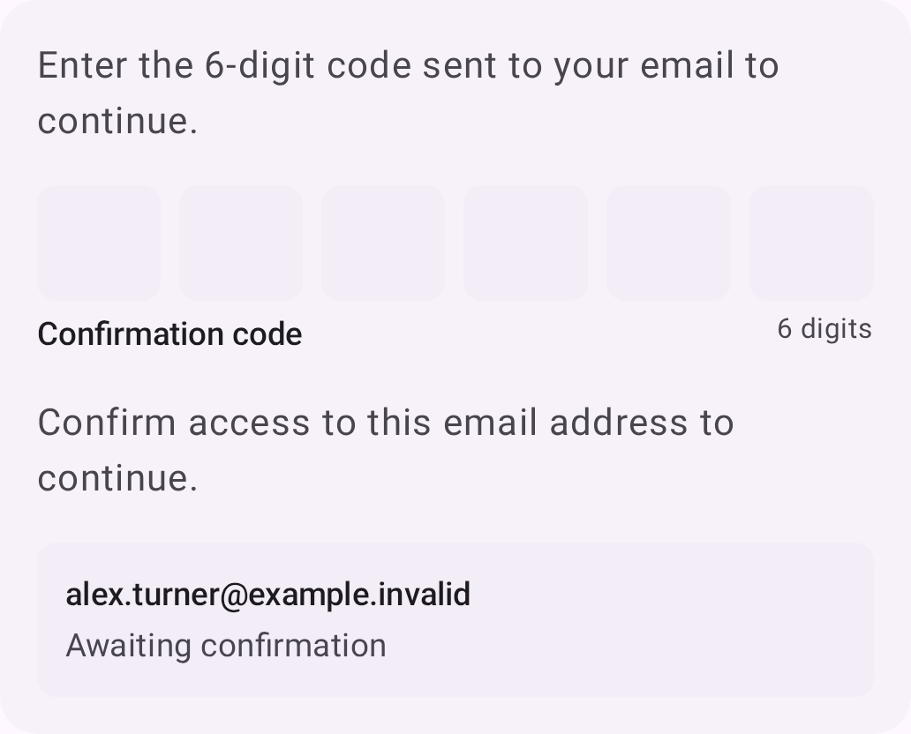
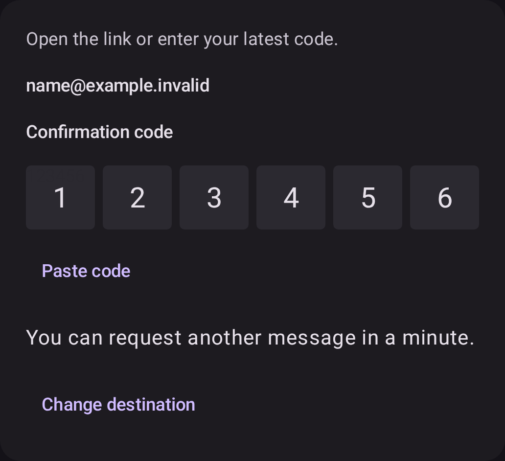

# Android UI Common

Reusable Material 3 Compose cards, catalogs and verification-code entry that inherit your app's theme.

**The split libraries are Development/source integration.** Historical monolithic releases remain available. Read [installation](IMPORT.md) and the
[consumer guide](docs/agents/index.md). The sample app demonstrates state, callbacks and localization.

| Component | Use |
| --- | --- |
| ContentCard / ActionCard | Custom content or a heading/body/action card |
| SectionHeading / EmptyStateCard | Accessible headings and caller-owned empty states |
| CatalogScreen | Centered scrolling catalog with header/empty-state slots |
| OneTimeCodeField | One logical numeric field with visual slots and explicit paste |
| CodeVerificationCard | Full verification card with host-owned messages/actions |
| VerificationRecipientRow | Wrapping recipient/status summary with optional decorative icons (Development) |

The detailed `VerificationCardDetails` overload is **Development source**, pending a new release;
it is not available in the confirmed 0.1.0 artifact. The original card signature remains supported.

| Detailed card, light | Detailed card, dark |
| --- | --- |
|  |  |

These are synthetic rendered documentation illustrations, not accepted regression baselines.
See [capture provenance](docs/screenshots/documentation.json). The sample also exposes **App settings**
above the demo list to open Android application details for its installed package. Choose a list
item to open its own offline example, then use **Back to demos** or system Back to return.
See [the demo guide](docs/agents/recipes.md#sample-demo-list) for the available examples.

Start with [quickstart](docs/agents/quickstart.md), [API contracts](docs/agents/api.md),
[migration](docs/agents/migration.md), [testing](docs/agents/testing.md) and [release maintenance](docs/releases.md).

```sh
sh ./setup.sh --help
./gradlew :ui-demo-common:testDebugUnitTest :ui-code-verification:testDebugUnitTest :ui-demo-common:lintDebug :ui-code-verification:lintDebug :app:assembleDebug
sh ./docs.sh check
sh ./docs.sh build --check
```

Setup/publishing and documentation use separately pinned shared CLIs. The website uses bundled Astro;
this repository owns its content and component evidence. Screenshot candidates require deliberate review.

## Development module split

Current source contains two independent libraries and one unpublished catalog app:

| Module | Components |
| --- | --- |
| `:ui-demo-common` | ContentCard, ActionCard, SectionHeading, EmptyStateCard, CatalogScreen |
| `:ui-code-verification` | OneTimeCodeField, CodeVerificationCard (both overloads), VerificationCardDetails, VerificationRecipientRow |
| `:app` | Unified catalog, navigation, examples and preview controls; depends on both libraries |

Neither library depends on the other. Kotlin packages remain `com.apexfission.android.ui.common`;
Android resource namespaces are `com.apexfission.android.ui.demo` and
`com.apexfission.android.ui.codeverification`. API 28, Java 17, host theming and caller-owned state remain unchanged.

The new modules are **Development/source integration**, with no confirmed published versions.
For a local multi-project build, depend on `project(":ui-demo-common")` and/or
`project(":ui-code-verification")`. Consumers should replace the monolithic dependency across
their complete dependency graph: never combine the old AAR with either extracted library,
because their Kotlin classes overlap. External consumer migrations and publishing automation
are deferred until the release follow-up. Historical release receipts remain unchanged;
release information below concerns the old monolithic artifact, not the split libraries.

## License

Project-owned code in all modules is licensed under [Apache 2.0](LICENSE). Third-party dependencies
and data retain their licenses/notices. Extracted source provenance is recorded in the migration guide.
