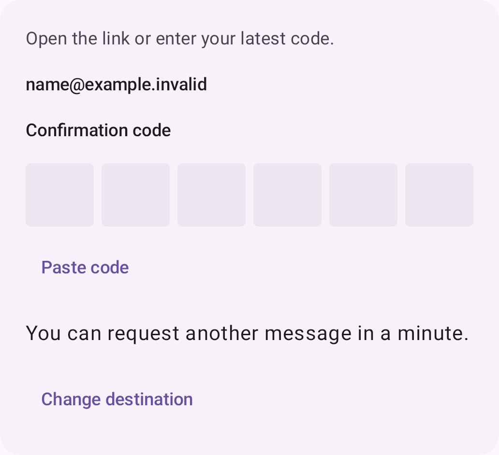
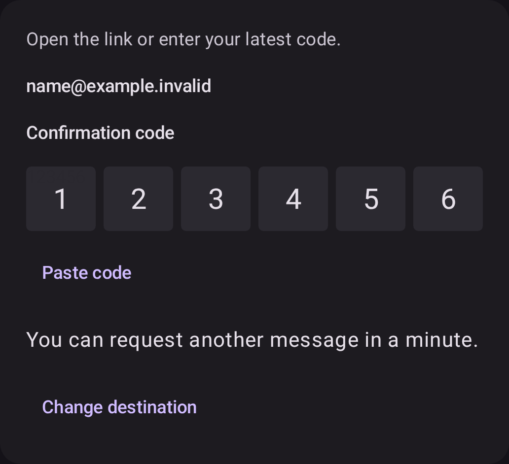
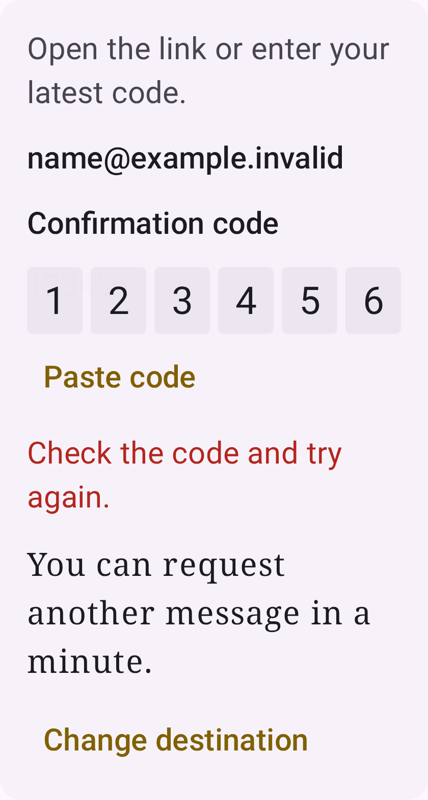
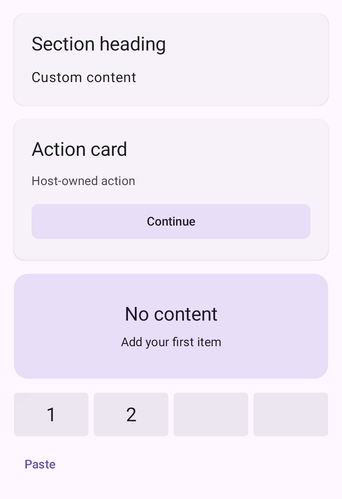

# Testing and screenshots

The library has deterministic offline previews and screenshot scenarios for cards, headings,
catalogs, field states, host theme and narrow/large text. The sample has English/Spanish previews.
Fixtures never access a server, Keystore, camera or real credentials.

```sh
./gradlew :ui-common:testDebugUnitTest :ui-common:lintDebug :app:lintDebug :app:assembleDebug
./gradlew :ui-common:assembleDebugAndroidTest
./gradlew :ui-common:connectedDebugAndroidTest
./gradlew :ui-common:validateDebugScreenshotTest :app:validateDebugScreenshotTest
sh ./docs.sh check
sh ./docs.sh build --check --base /
sh ./docs.sh build --check --base /android.ui.common/
```

Connected tests require an emulator/device. Screenshot validation compares reviewed baselines;
initial rendered output is a candidate, not an accepted baseline. See [screenshot policy](../screenshots/README.md)
for rendering and intentional acceptance. Do not refresh baselines merely to silence a difference.
Unit tests cover normalization; Compose tests cover callbacks, semantics, input and explicit paste.
Host screenshots do not prove system autofill, IME or physical-device behavior.

## Rendered examples

These locally rendered illustrations were inspected for layout and host-theme inheritance. They are
not approved regression baselines or evidence of device autofill behavior.





