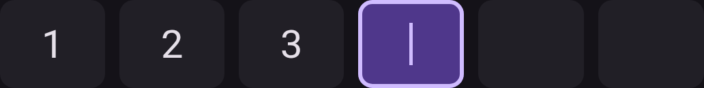
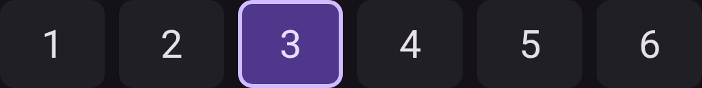

# Testing and screenshots

The library has deterministic offline previews and screenshot scenarios for cards, headings,
catalogs, field states, host theme and narrow/large text. The sample has English/Spanish previews.
Fixtures never access a server, Keystore, camera or real credentials.

```sh
./gradlew :ui-common:testDebugUnitTest :ui-common:lintDebug :app:lintDebug :app:assembleDebug
./gradlew :ui-common:assembleDebugAndroidTest :app:assembleDebugAndroidTest
./gradlew :ui-common:connectedDebugAndroidTest :app:connectedDebugAndroidTest
./gradlew :ui-common:validateDebugScreenshotTest :app:validateDebugScreenshotTest
sh ./docs.sh check
sh ./docs.sh build --check --base /
sh ./docs.sh build --check --base /android.ui.common/
```

Connected tests require an emulator/device. Screenshot validation compares reviewed baselines;
initial rendered output is a candidate, not an accepted baseline. See [screenshot policy](../screenshots/README.md)
for rendering and intentional acceptance. Do not refresh baselines merely to silence a difference.
Unit tests cover normalization; Compose tests cover callbacks, semantics, input and explicit paste.
The sample device tests check the top App settings intent, return and recreation. The detailed card
tests check one logical input, host-owned recipient status and a shared action row below the recipient.
They also check narrow/large-text actions, error semantics and notice order, and focus during error recovery. Input
tests tap individual cells, replace digits, delete and paste. They inspect selection semantics and
rendered border pixels to verify that the visible highlight follows the actual editing position.
Host screenshots do not prove system autofill, IME or physical-device behavior.

## Rendered examples

These CI-rendered Development illustrations were inspected for layout and host-theme inheritance. They are
not approved regression baselines or evidence of device autofill behavior.


| Next empty digit | Editing the third digit |
| --- | --- |
|  |  |

These focused-state illustrations use the same cell renderer as the logical input. Device tests
separately exercise real taps and typing; the illustrations do not substitute for interaction tests.
