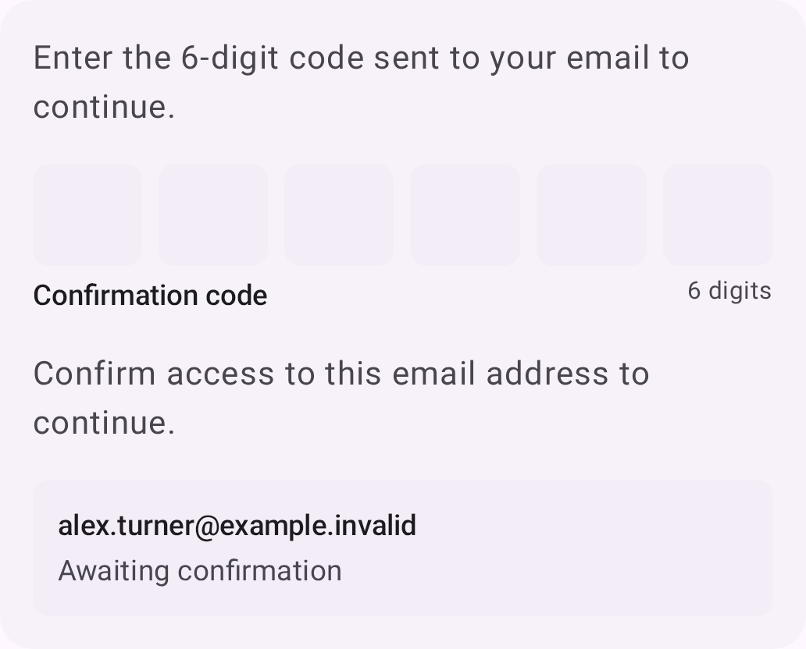
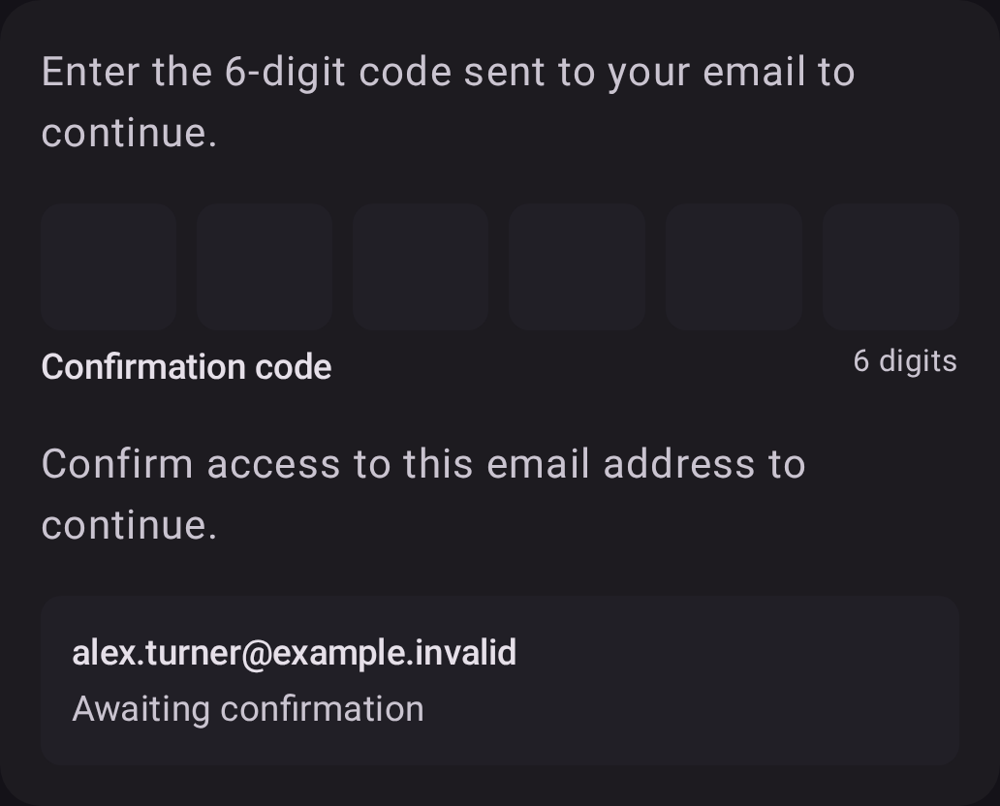

# UI Common

Componentes Kotlin/Compose Material 3 para tarjetas, catálogos y códigos de verificación. La aplicación controla el tema, el estado, los textos, la navegación y las operaciones de red.

- [Instalación](installation.md): dependencia publicada e integración desde el código fuente.
- [Inicio rápido](quickstart.md): tarjeta y campo de código.
- [API](api.md): componentes y responsabilidades.
- [Recetas](recipes.md): personalización e integración.
- [Pruebas](testing.md): interacción y capturas.
- [Migración](migration.md): reemplazos de Demo Common y Auth.
- [Solución de problemas](troubleshooting.md).
- [Referencia del código](source-reference.md): declaraciones generadas; se muestra en inglés cuando no existe traducción revisada.

La versión 0.1.0 está confirmada en JitPack. Utiliza las coordenadas exactas de [IMPORT.md](../../IMPORT.md); estas guías actuales también pueden describir trabajo en desarrollo.

La sobrecarga detallada de la tarjeta y el resumen del destinatario son **código de Development**,
pendientes de una nueva versión. Heredan el tema del host y no deducen éxito en la verificación.

| Claro | Oscuro |
| --- | --- |
|  |  |

Ilustraciones sintéticas para documentación; [procedencia](../screenshots/documentation.json).
Estas imágenes no son referencias de regresión aceptadas.
