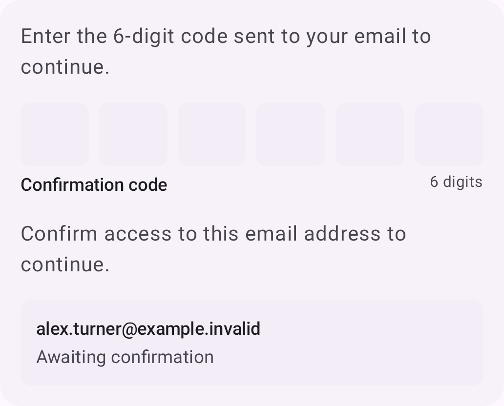
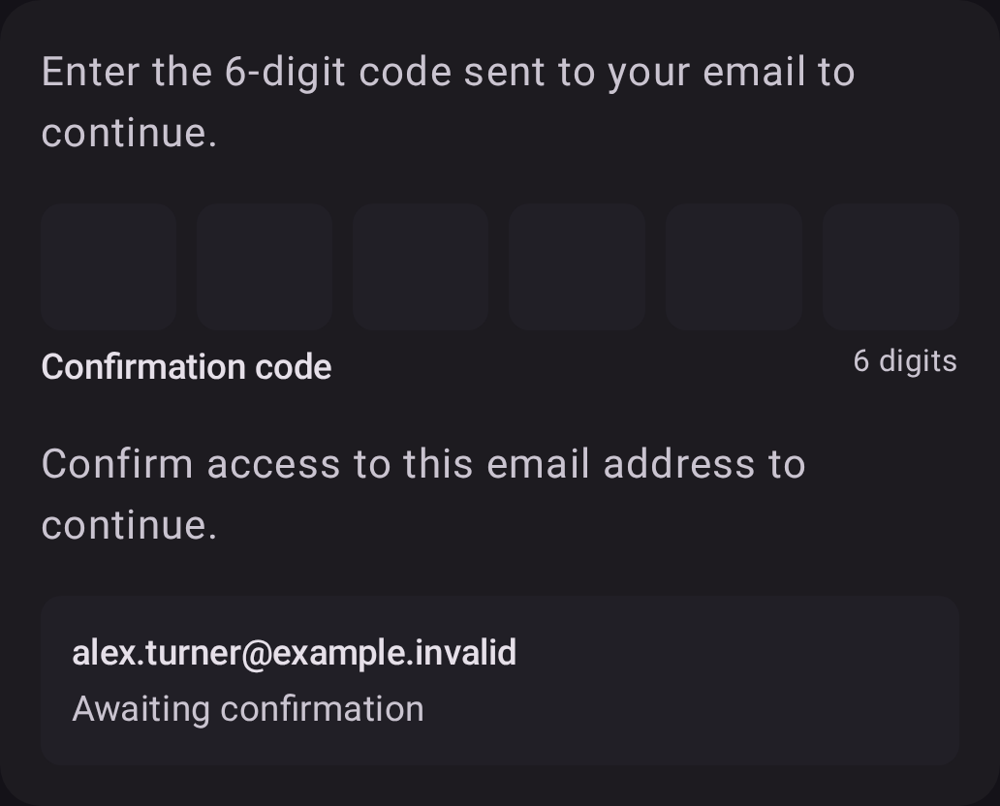
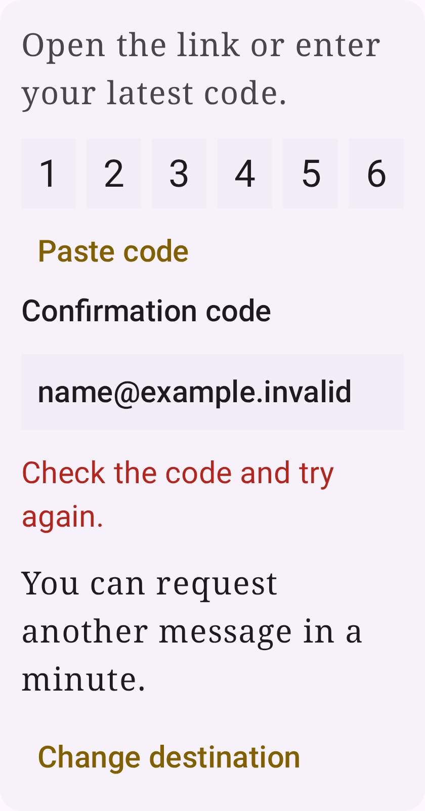
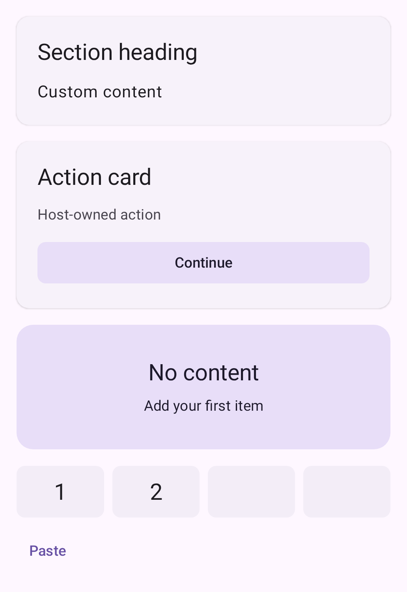

# Pruebas y capturas

Las vistas previas y los escenarios deterministas cubren tarjetas, encabezados, catálogos, estados del código, tema alternativo, pantallas estrechas y texto grande. La aplicación incluye inglés y español. Las muestras no acceden a servidores, Keystore, cámara ni credenciales reales.

```sh
./gradlew :ui-common:testDebugUnitTest :ui-common:lintDebug :app:lintDebug :app:assembleDebug
./gradlew :ui-common:assembleDebugAndroidTest :app:assembleDebugAndroidTest
./gradlew :ui-common:connectedDebugAndroidTest :app:connectedDebugAndroidTest
./gradlew :ui-common:validateDebugScreenshotTest :app:validateDebugScreenshotTest
sh ./docs.sh check
sh ./docs.sh build --check --base /
sh ./docs.sh build --check --base /android.ui.common/
```

Las pruebas conectadas necesitan un emulador o dispositivo. La validación visual compara referencias revisadas; una imagen recién generada es una candidata, no una referencia aprobada. Consulta la [política de capturas](../screenshots/README.md). No actualices referencias solo para ocultar diferencias.

Las pruebas unitarias cubren la normalización; las de Compose cubren callbacks, semántica, entrada y pegado explícito. Las pruebas del ejemplo comprueban App settings, su destino, el regreso y la recreación. La tarjeta detallada comprueba un único campo lógico y el estado controlado por el host. Las capturas no demuestran el comportamiento del autocompletado del sistema, el teclado ni los dispositivos físicos.

## Ejemplos renderizados

Se revisaron estas ilustraciones de Development renderizadas en CI para comprobar el diseño y la herencia del tema. No son referencias
visuales aprobadas ni evidencia del autocompletado en dispositivos.





